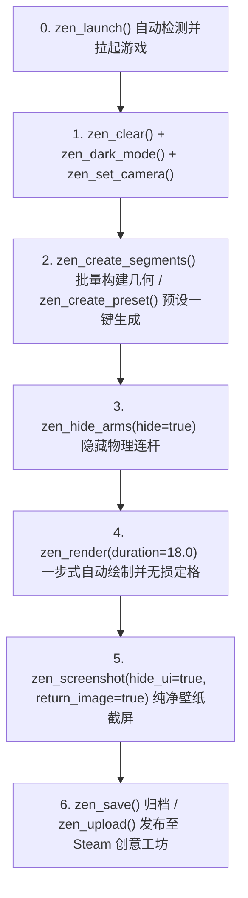

# Zen Trails AI 创作者指引 (AI Agent Creator Guide)

本手册专为接入 Zen Trails MCP 服务的 AI Agent 编写，旨在让任何初次接入的大语言模型无需任何逆向背景，即可快速掌握游戏运行机制并创作出震撼的流光几何艺术。

---

## 核心机制：多连杆逆旋摆线（Multi-Pendulum Kinematics）

Zen Trails 是一个基于物理与几何规律的流光绘图发生器。游戏的核心对象是 **线段（Segment）**：
- **根线段（Root Segment）**：一端固定在原点 `(0, 0)`，以恒定角速度 `speed` 旋转；
- **子线段（Child Segment）**：挂载在父线段的末梢端点上，自身以独立角速度旋转；
- **流光渲染器（TrailRenderer）**：仅在物理运转时跟随端点轨迹生成发光色带。

### 神圣几何与图形生成公式表

| 图形类别 | 母臂与子臂速比 ($\omega_1 : \omega_2$) | 臂长比例建议 | 视觉特征 |
|---------|--------------------------------------|-------------|---------|
| **同心真圆** | 单臂旋转或母子同步同向 ($1 : 1$) | 任意长度 | 纯净圆形防护罩、内外隔离结界环 |
| **三叶/六瓣生命之花 (Rosette)** | **$1 : -2$ (逆向 2 倍速)** | $L_1 \approx L_2$ (如 1.35 : 1.05) | **经典生命之花圣轮**。若以 30° 步进排布 12 组，将交织成重叠神圣莲华 |
| **四角菱晶星芒 (Astroid)** | **$1 : -3$ (逆向 3 倍速)** | $L_1 \approx L_2$ (如 0.80 : 0.80) | 锋锐的四角星芒/钻石星轮 |
| **六角星芒 (Hexagram)** | **$1 : -5$ (逆向 5 倍速)** | $L_1 \approx L_2$ | 经典六芒星光带 |
| **日轮耀斑光冠 (Solar Corona)** | **$1 : -23$ (高频极端逆旋)** | $L_1 \gg L_2$ (如 4.75 : 0.45) | 最外层向外辐射喷薄的 24 芒金焰短齿 |
| **黄金角曼陀罗 (Mandala)** | 串联多级连杆，初始角递增 137.5° | $L$ 逐级衰减 ($0.95^n$) | 黄金比例自然螺旋分形 |

---

## 创作标准流程 (Standard Workflow)

请遵循以下标准调用链路，以保证图案纯净、完整闭合且不发生闪退：

### 极度关键的避坑守则 (Must-Know Rules)
1. **优先使用 `zen_render(duration=18.0)` 替代分步等待**：`zen_render` 内部自动完成物理运行与 `TogglePause` 定格，杜绝误触清空轨迹或延时不准的问题。如需手动控制，**切勿在定格后二次调用 `zen_play`**（会清空画布）。
2. **隐藏机械臂必须通过 `zen_hide_arms(hide=true)`**：若未隐藏物理连杆，截屏时画面会带有粗糙的白色连杆模型，影响流光艺术美感。
3. **载波卫星法阵（Off-Center Satellite Circles）**：
   - 将母臂设为 `speed: 0`、`draw_trail: false`，其端点即可作为一个位于非原点的**静态星位锚点**；
   - 在此母臂末梢挂载子线段并设定转速，即可在离心位置绘制独立的卫星子魔法阵。

---

## 常用神圣色彩体系 (Sacred Palettes)

`zen_create_segment` / `zen_create_segments` / `zen_create_preset` 的 `color` 参数支持直接传入色彩别名：

- `gold` (`1.00,0.85,0.28,1`) —— 太阳真金，用于主轮、神圣符印与日轮耀斑；
- `cyan` (`0.20,0.92,1.00,1`) —— 苍穹碧蓝，用于外层天界、隔离防护环与星芒；
- `magenta` (`1.00,0.25,0.58,1`) —— 宇宙洋红，与黄金交错构建生命之花双色圣轮；
- `violet` (`0.78,0.32,1.00,1`) —— 虚空紫晶，用于中阶结界与内殿符文；
- `amber` (`1.00,0.60,0.15,1`) —— 炽阳琥珀，用于三曜火精从阵；
- `white` (`1.00,0.98,0.90,1`) —— 极光白金，用于中心奇点高亮内核；
- `rose` (`1.00,0.20,0.50,1`) —— 绯红玫瑰，用于莲华瓣轮；
- `aqua` (`0.25,1.00,0.85,1`) —— 翡翠灵能，用于四象星菱晶印。

也可直接传入自定义 RGBA 字符串（如 `"0.4, 0.8, 1.0, 1.0"`）。

---

## 工具分层总览

### 1. 生命周期与就绪管理 (Lifecycle & Readiness)
- `zen_launch(timeout=30.0, auto_enter=true)`：完全路径无关！基于 Steam 协议（`steam://run/1418570`）或多盘 Steam 库动态扫描启动游戏，并轮询等待 TCP Bridge 握手成功；
- `zen_status()`：检查游戏进程状态、Bridge 连接延迟、FPS、当前仿真状态及活动线段计数；
- `zen_quit()`：优雅退出游戏。

### 2. 高阶创作与渲染工具 (Creation & Rendering)
- `zen_clear()`：一键安全重置画布与线段编号计数器；
- `zen_dark_mode(color="0.02,0.02,0.04,1")`：切换深邃宇宙夜空，关闭原生干扰背景；
- `zen_set_camera(distance=-12.5)`：调整视距（微型曼陀罗用 `-10.5`，宏大法阵用 `-12.8`）；
- `zen_create_segment(...)`：单条创建线段，自动隐藏机械网格与管理 ID；
- `zen_create_segments(segments=[...])`：**批量连杆事务创建**，一次 RPC 即可构建 10~20 级宏大法阵骨架；
- `zen_create_preset(name="flower_of_life", ...)`：**经典几何预设一键生成**（支持 `flower_of_life`、`solar_corona`、`dodecagram`、`hexagram`、`astroid`、`concentric_ring`）；
- `zen_hide_arms(hide=true)`：切换物理机械臂的显示与隐藏；
- `zen_render(duration=18.0, pause_after=true)`：**一步式流光渲染**，自动运行指定时长并无损定格；
- `zen_play()` / `zen_pause()`：底层模拟器启动与定格控制；
- `zen_list_segments()`：查看当前作品的完整骨架列表与参数。

### 3. 画面与发布工具 (Visuals & Publishing)
- `zen_set_ui(visible=bool)`：一键显示或隐藏全部游戏 UI；
- `zen_screenshot(name="...", hide_ui=true, return_image=true)`：高清采样并内联返回给视觉模型，默认自动屏蔽一切 UI 按钮；
- `zen_save(name="...", type="custom")`：保存为官方 `.mndla` 二进制存档；
- `zen_load(name="...", type="custom")`：载入历史存档；
- `zen_upload(title="...", description="...")`：全自动无 UI 纯净拍摄并推送到 Steam 创意工坊；
- `zen_music(song="...")`：切换背景禅音（Mandalas / Wavelengths / Footprints / Dreams / Space）。

### 4. 底层调试逃生通道 (Low-Level Escape Hatch)
- `zen_cmd(command, args)`、`zen_call(selector, method, args)`、`zen_get`、`zen_set`、`zen_scene`、`zen_types`、`zen_describe` 等原生反射接口，用于深度逆向探索。
